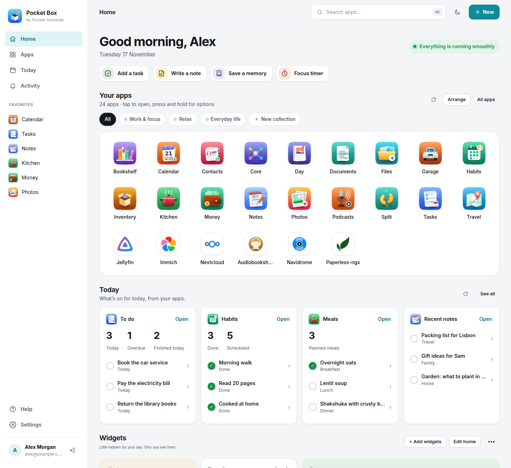
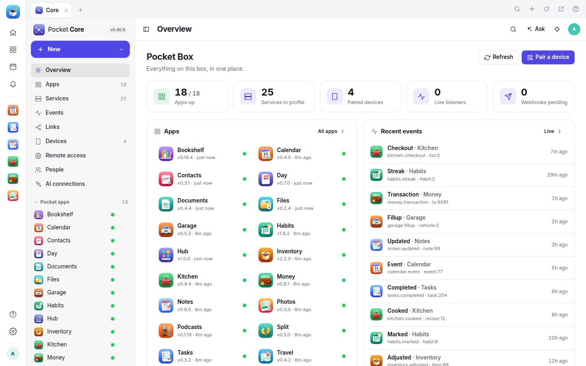
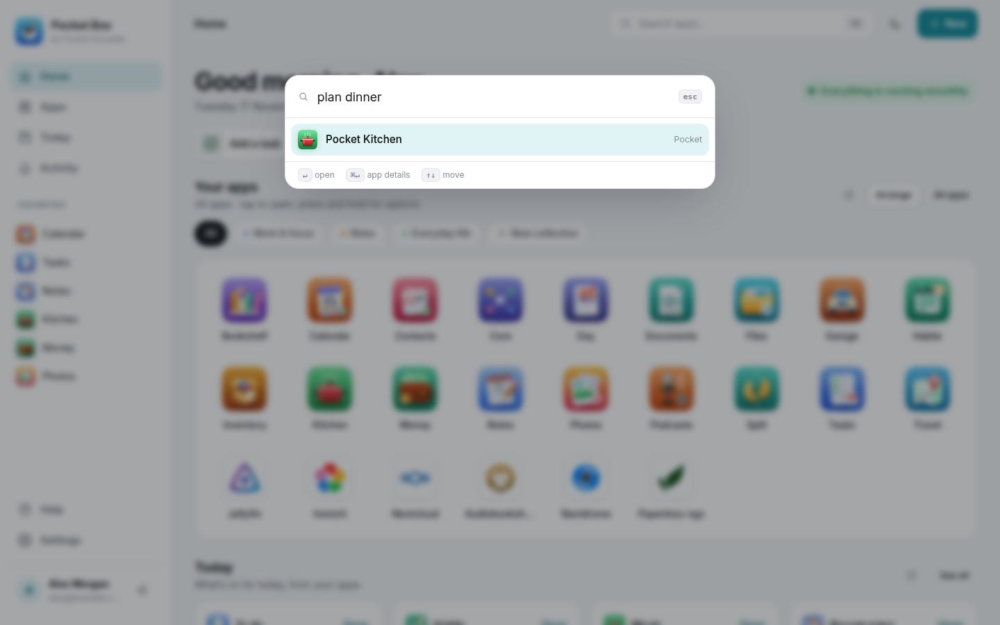
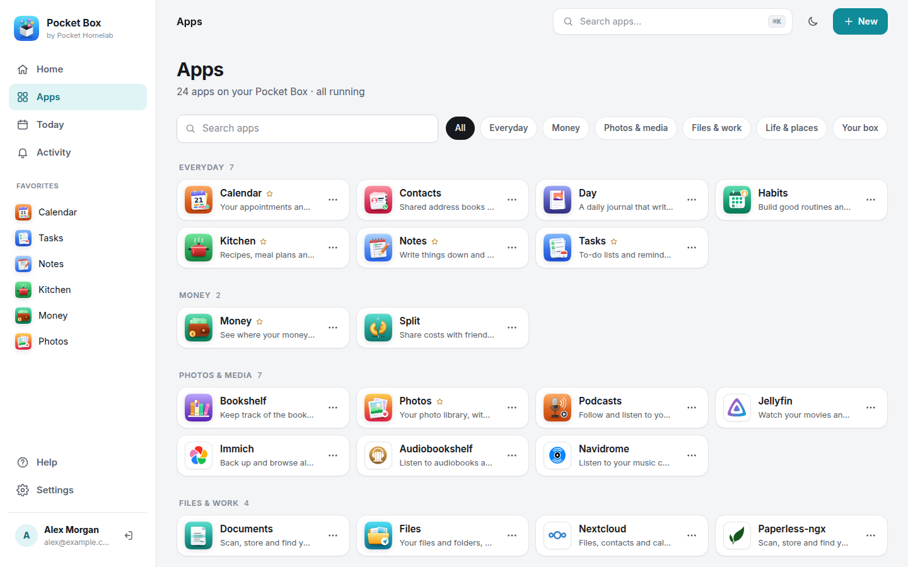
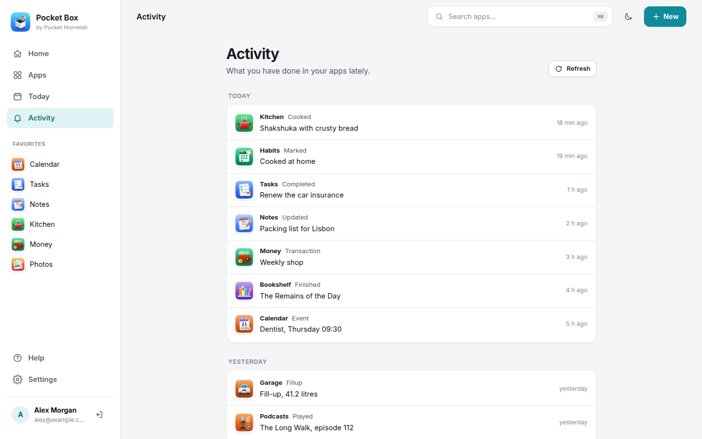
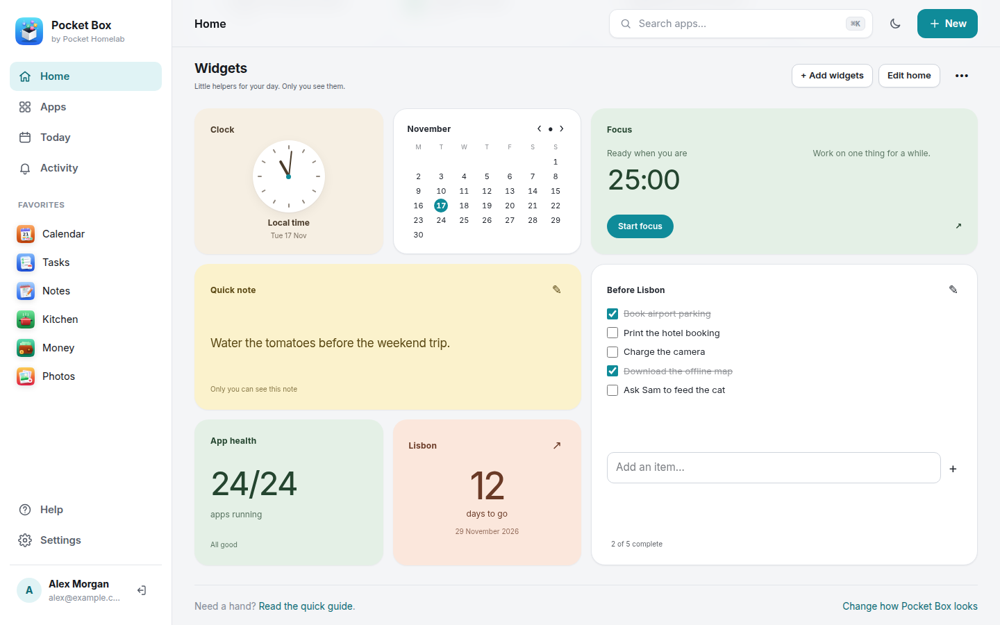
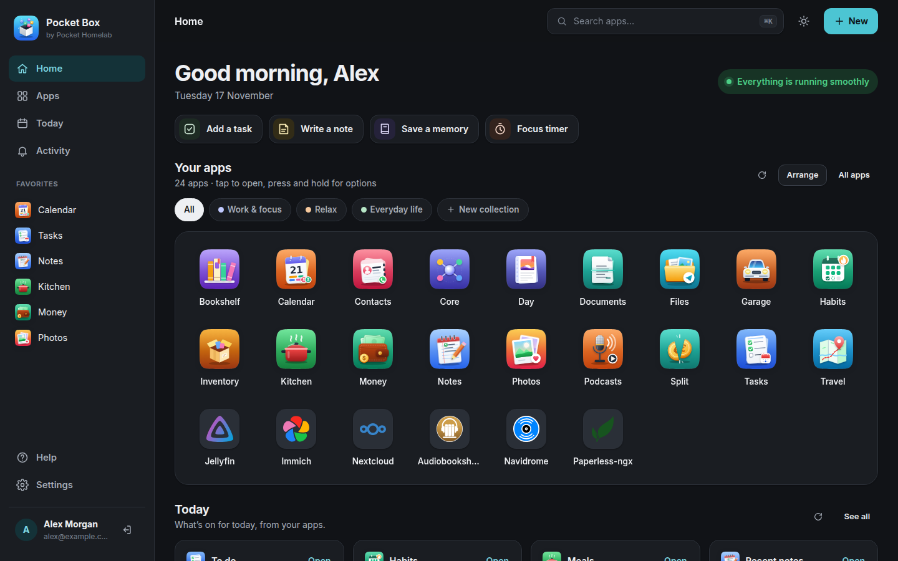
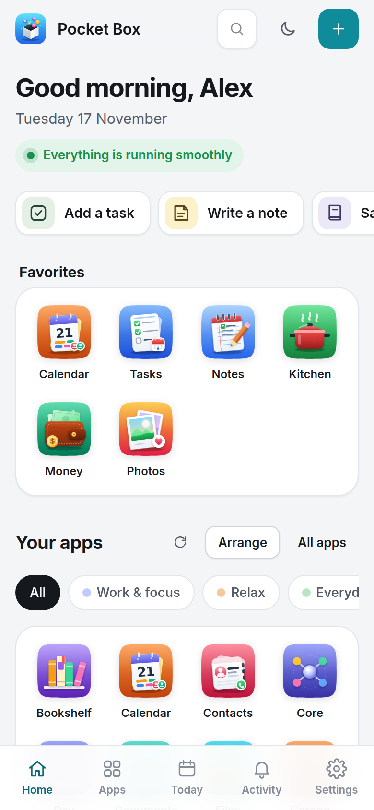
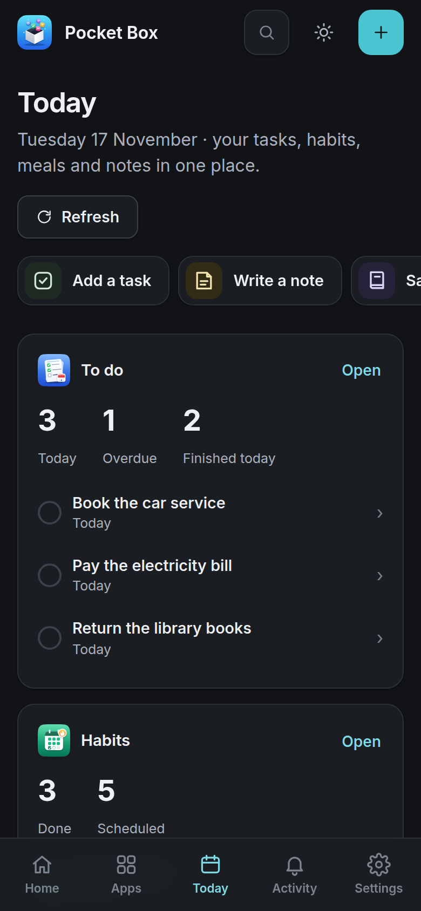

<p align="center">
  
</p>
<h1 align="center">Pocket Hub</h1>
<p align="center">
  The customer home and unified app workspace for a <b>Pocket Box</b>: a personal home with daily summaries, quick capture, customizable widgets, personal spaces, a focus room, intent search, and apps that stay open as you move through your day. Connected to <a href="https://github.com/abjelosevic88/pocket-homelab-core">Pocket Core</a>.<br>
  <b>One binary · one SQLite file · one volume · nothing of its own to configure.</b>
</p>
<p align="center">
  <a href="https://github.com/abjelosevic88/pocket-homelab-hub/actions"></a>
  <a href="https://github.com/abjelosevic88/pocket-homelab-hub/pkgs/container/pocket-homelab-hub"></a>
  <a href="LICENSE"></a>
</p>

---

A Pocket Box runs a dozen Pocket apps and a few dozen third-party services, and Pocket Core knows which of them each person in the household may use. The hub is the window on that: it has no app list of its own. A person signs in with Pocket Core, the hub reads *their* launcher from Core with *their* token, and draws it.

- **A home that’s yours.** A searchable gallery of widgets: clock, calendar, focus, favorites, recently opened apps, activity, spaces, app shortcuts, quick notes, checklists, countdowns, photo frames, app health, Box information, things to do, live widgets for Tasks, Habits, Kitchen and Notes, and one for every other app that says it has a summary to show (the app names it and fills it; nothing is added in Hub). Add up to 24 widgets, choose supported small/medium/large sizes, and arrange them with touch, mouse or keyboard. Notes, checklists and layout save to your account. Remove with undo; restore starter widgets; hide the spaces or app grid. [Widget behavior and extension guide](docs/widgets.md).
- **Personal touches.** The distinctive open-lid Pocket Box icon, a labeled favorites sidebar, adjustable home atmosphere, app order and hidden apps. Long-press or right-click an app tile for details; *Edit layout* to arrange apps.
- **Your day together.** Today brings tasks due, habit check-ins, planned meals and recently edited notes into one personal view, with independent source refresh and honest unavailable states. Any other Pocket app joins on its own once it says it has a summary: its card carries the title, the line, the numbers and the rows the app sends, and a row opens that very item.
- **Catch a thought anywhere.** Capture a task, note or journal moment from the top bar without leaving an open app, or anything else one of your apps says it can keep (listed under *More*, by app, with only the fields that kind takes). A day is sent only when you pick one, so the app decides the rest (an event typed at 5 pm for "3pm" lands tomorrow, not in the past); a journal moment keeps today unless you change it. Choose the destination, save to your own account, open the new item straight away, and keep unfinished drafts while moving around Hub. Retried saves have duplicate protection. [Today and capture guide](docs/daily-and-capture.md).
- **A unified workspace.** Apps open inside Hub with persistent navigation and an app switcher. Going Home or switching apps preserves open app state; closing a tab or reloading the browser ends that workspace. Tiles for Pocket apps open the app's *Sign in with Pocket Core* entry, so the click lands you in the app as yourself, even on a browser that was someone else a minute ago. Third-party apps need compatible embedding and sign-in settings; see the [customer experience and integration guide](docs/customer-experience.md).
- **Intent search.** ⌘K, type an app or “plan dinner,” enter. Matching runs locally against your available apps.
- **Personal spaces.** Focus, downtime, everyday life, or a custom set of apps saved to your account.
- **A focus room.** 15, 25 or 50 minutes; pause, resume, leave and return. Focus sessions and recent apps stay in this browser, scoped to your account.
- **An app library.** Every app in your profile with description, version, group and health; search and filter; hide the ones you never open.
- **Activity.** What the apps published about you (the admin sees the household's bus too), grouped by day, linking back into the app. Members see their own doings in the Pocket apps that let the hub read them: the hub asks each app for an `events:read` link, which the admin and every person can switch off in Core.
- **Honest about who sees what.** The hub never reads the person's list with its own app token. Core's audience rules decide, the hub only draws.

<p align="center"></p>

<table>
  <tr>
    <td width="50%"></td>
    <td width="50%"></td>
  </tr>
  <tr>
    <td align="center"><sub>Apps open inside the hub as tabs and keep their place while you move around.</sub></td>
    <td align="center"><sub>Type what you want to do; the hub finds the app for it.</sub></td>
  </tr>
  <tr>
    <td width="50%"></td>
    <td width="50%"></td>
  </tr>
  <tr>
    <td align="center"><sub>Every app in your profile, searchable and filterable.</sub></td>
    <td align="center"><sub>What the apps recorded about you, grouped by day.</sub></td>
  </tr>
  <tr>
    <td width="50%"></td>
    <td width="50%"></td>
  </tr>
  <tr>
    <td align="center"><sub>Widgets you add, size and arrange yourself.</sub></td>
    <td align="center"><sub>Dark mode.</sub></td>
  </tr>
</table>

<p align="center">
  &nbsp;&nbsp;
  
</p>

## Run it

```sh
docker run -d --name pocket-hub -p 8080:8080 -v ./data:/data \
  -e BASE_URL=https://hub.example.com -e SECURE_COOKIES=true \
  -e CORE_URL=http://pocket-core:8080 -e CORE_REGISTRATION_KEY=pcreg_… \
  ghcr.io/abjelosevic88/pocket-homelab-hub:latest
```

or `docker compose up -d` with the included `docker-compose.yml`, or the single binary from the releases page. Open it and press **Sign in with Pocket Core**. The first person to sign in owns the hub (the role is cosmetic: what you see is decided by Core).

`BASE_URL` is where browsers reach the hub; Core sends people back there after sign-in. `CORE_APP_URL` is how Core reaches the hub for health checks when that differs (container name, host gateway). `CORE_PUBLIC_URL` is what the *Pocket Core* tile opens (defaults to Core's own issuer).

Without `CORE_URL` the hub starts, signs you in with a password if `PASSWORD_LOGIN=true`, and shows an empty desk with instructions. It is not useful on a box without Core.

## How it reads Core

| What | Read as | Endpoint |
|---|---|---|
| the person's tiles | the person (their OIDC tokens from sign-in, refreshed; or the `pcd_`/`pcu_` token a phone presented) | `GET /api/v1/me/services` |
| health, version, description of Pocket apps already on the list, and the `category` (shelf) an app names for itself | the hub (`pca_`) | `GET /api/v1/apps` |
| which apps offer a widget or quick capture to this person, and whether each link is on | the hub, for the person's email | `GET /api/v1/links/status?user=&scope=pocket:widget` / `pocket:capture` |
| a token to read one app's widget or keep one quick line there: valid only in that app, for that one scope, for five minutes | the hub, for the person's email | `POST /api/v1/links/token` |
| box name, Core version, uptime | the hub | `GET /api/v1/system` |
| activity | the person first (`GET /api/v1/events`, which Core answers only for admins), else the hub through its `events:read` links, filtered to the person | `GET /api/v1/events` |

Rules the feed applies before showing anything: an event that names a person (`user_email`) is shown only to that person; a household event (none named) is shown when its app is on the person's list; `core.*` events other than `core.app.*` are for admins.

### Widgets and quick capture come from the apps

Hub has no list of apps it can show a widget for or send a quick line to. A Pocket app says so itself, in the manifest it registers with Core ([capabilities](https://github.com/abjelosevic88/pocket-homelab-core/blob/main/docs/capabilities.md)): `widget: {title, what}` and `capture: {kinds: [{kind, label, what, fields}]}`. Hub asks Core which apps offer that to the person and calls each one through a **Core link**:

| What | Asked of the app | Becomes |
|---|---|---|
| the app's widget | `GET /api/v1/pocket/widget` with a link token for `pocket:widget` | a source in `GET /api/v1/daily` (a card on Today, a widget in the gallery) |
| a quick line | `POST /api/v1/pocket/capture` with a link token for `pocket:capture` | a destination in `GET /api/v1/daily`, saved through `POST /api/v1/capture` |

So a new app needs nothing in Hub: once it offers the capability, its widget and its capture kinds are there.

**Two switches in Pocket Core, once.** Hub's manifest asks for the two scopes in *every* app that offers them, as two rules. After updating Hub, an admin switches them on in Pocket Core → **Links** → Pocket Hub:

- **Show a summary** (`pocket:widget`): "Show a few lines from each of your apps on your home screen and on Today"
- **Keep a quick line** (`pocket:capture`): "Keep a quick line you type in Pocket Hub in the app you choose"

From then on Core makes the link for every app that offers one, apps installed later included. The admin can still switch a single app off on the same page, and each person can switch a single app off for themselves in Pocket Core → Settings → *Apps acting for me*. An app whose link is off is not asked; its widget says why it is empty, and quick capture leaves it out.

**What goes where.** A link token works only in the one app, only on the one route, for five minutes. The person's own Core token, which works as the person everywhere, is not used for any of this. Tasks, Habits and Notes are reached through their links like every other app; when a link is off, their widget says why and quick capture leaves them out.

Two apps offer neither yet, so Hub keeps one hand-written route for each, called with the person's own token at the address Core has for them: Kitchen's meal plan for the day (its widget) and a journal moment in Day (quick capture). Once one of them offers the same thing through Core, Hub uses the link only. An app may also name its shelf (`category`: "Money", "Home", "Media"…); Hub puts it on the nearest of its own shelves. Details: [Today and capture](docs/daily-and-capture.md).

The hub's own API is small: `/api/v1/launcher`, `/activity`, `/daily`, `/capture`, `/prefs`, `/system`, and the usual `/auth/*`. It accepts the hub session cookie or a Core token (`Authorization: Bearer pcd_…`), so the Pocket Homelab app can read the same launcher. See [docs/configuration.md](docs/configuration.md).

## Develop

```sh
make dev     # API on :8080 with no login, Vite on :5173
make test    # go vet + go test (OIDC sign-in against a fake provider, per-person launcher and feed rules) + tsc
make all     # web + binary with the UI embedded
```

Go 1.26, React 19, chi, modernc SQLite (no cgo). The Core SDK is vendored under `third_party/pocket-core` with a checksum lock. Service icons in `web/public/icons` come from [homarr-labs/dashboard-icons](https://github.com/homarr-labs/dashboard-icons) (Apache-2.0); Pocket apps supply their own.

## License

MIT.

### Pocket Homelab identity

The customer shell uses the owner-selected **Pocket Box** icon: an open white box with app tiles swirling up out of it, on a cyan-to-blue tile. It comes from the shared Pocket icon generator (see `docs/design/pocket-box-icon.md`). The main app image is `web/public/pocket-box.png`, and the browser, Apple and installable-app sizes are rendered from the same SVG. The legacy `favicon.svg` URL also shows the box for existing shortcuts.

Home combines personal daily summaries with the existing widget layout. Labeled navigation and favorites replace the floating dock; phones use a fixed navigation bar. Existing favorite keys, wallpapers, widgets and explicitly enabled home app grids remain intact. The full app grid is off by default for new layouts and available in the library or through Home options. Selecting or saving a Space reveals its apps.
