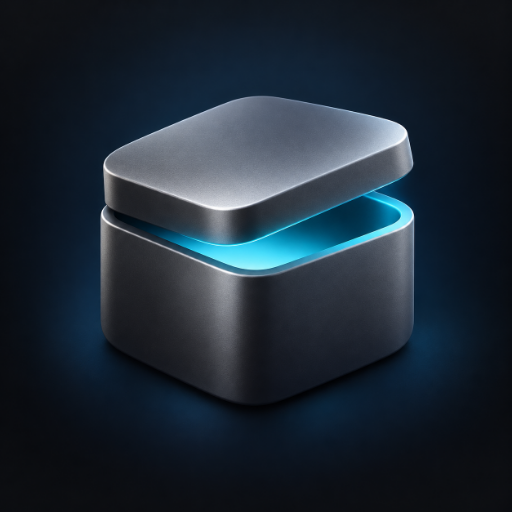

<p align="center">
  
</p>
<h1 align="center">Pocket Hub</h1>
<p align="center">
  The customer home and unified app workspace for a <b>Pocket Box</b>: a personal home with daily summaries, quick capture, customizable widgets, personal spaces, a focus room, intent search, and apps that stay open as you move through your day. Connected to <a href="https://github.com/abjelosevic88/pocket-homelab-core">Pocket Core</a>.<br>
  <b>One binary · one SQLite file · one volume · nothing of its own to configure.</b>
</p>
<p align="center">
  <a href="https://github.com/abjelosevic88/pocket-homelab-hub/actions"></a>
  <a href="https://github.com/abjelosevic88/pocket-homelab-hub/pkgs/container/pocket-homelab-hub"></a>
  <a href="LICENSE"></a>
</p>

---

A Pocket Box runs a dozen Pocket apps and a few dozen third-party services, and Pocket Core knows which of them each person in the household may use. The hub is the window on that: it has no app list of its own. A person signs in with Pocket Core, the hub reads *their* launcher from Core with *their* token, and draws it.

- **A home that’s yours.** A searchable gallery of 19 widget types: clock, calendar, focus, favorites, recently opened apps, activity, spaces, app shortcuts, quick notes, checklists, countdowns, photo frames, app health, Box information, things to do, and four live widgets for Tasks, Habits, Kitchen and Notes. Add up to 24 widgets, choose supported small/medium/large sizes, and arrange them with touch, mouse or keyboard. Notes, checklists and layout save to your account. Remove with undo; restore starter widgets; hide the spaces or app grid. [Widget behavior and extension guide](docs/widgets.md).
- **Personal touches.** The distinctive open-lid Pocket Box icon, a labeled favorites sidebar, adjustable home atmosphere, app order and hidden apps. Long-press or right-click an app tile for details; *Edit layout* to arrange apps.
- **Your day together.** Today brings tasks due, habit check-ins, planned meals and recently edited notes into one personal view, with independent source refresh and honest unavailable states.
- **Catch a thought anywhere.** Capture a task, note or journal moment from the top bar without leaving an open app. Choose the destination, save to your own account, and keep unfinished drafts while moving around Hub. Retried saves have duplicate protection. [Today and capture guide](docs/daily-and-capture.md).
- **A unified workspace.** Apps open inside Hub with persistent navigation and an app switcher. Going Home or switching apps preserves open app state; closing a tab or reloading the browser ends that workspace. Tiles for Pocket apps open the app's *Sign in with Pocket Core* entry, so the click lands you in the app as yourself, even on a browser that was someone else a minute ago. Third-party apps need compatible embedding and sign-in settings; see the [customer experience and integration guide](docs/customer-experience.md).
- **Intent search.** ⌘K, type an app or “plan dinner,” enter. Matching runs locally against your available apps.
- **Personal spaces.** Focus, downtime, everyday life, or a custom set of apps saved to your account.
- **A focus room.** 15, 25 or 50 minutes; pause, resume, leave and return. Focus sessions and recent apps stay in this browser, scoped to your account.
- **An app library.** Every app in your profile with description, version, group and health; search and filter; hide the ones you never open.
- **Activity.** What the apps published about you (the admin sees the household's bus too), grouped by day, linking back into the app. Members see their own doings in the Pocket apps that let the hub read them: the hub asks each app for an `events:read` link, which the admin and every person can switch off in Core.
- **Honest about who sees what.** The hub never reads the person's list with its own app token. Core's audience rules decide, the hub only draws.

## Run it

```sh
docker run -d --name pocket-hub -p 8080:8080 -v ./data:/data \
  -e BASE_URL=https://hub.example.com -e SECURE_COOKIES=true \
  -e CORE_URL=http://pocket-core:8080 -e CORE_REGISTRATION_KEY=pcreg_… \
  ghcr.io/abjelosevic88/pocket-homelab-hub:latest
```

or `docker compose up -d` with the included `docker-compose.yml`, or the single binary from the releases page. Open it and press **Sign in with Pocket Core**. The first person to sign in owns the hub (the role is cosmetic: what you see is decided by Core).

`BASE_URL` is where browsers reach the hub; Core sends people back there after sign-in. `CORE_APP_URL` is how Core reaches the hub for health checks when that differs (container name, host gateway). `CORE_PUBLIC_URL` is what the *Pocket Core* tile opens (defaults to Core's own issuer).

Without `CORE_URL` the hub starts, signs you in with a password if `PASSWORD_LOGIN=true`, and shows an empty desk with instructions. It is not useful on a box without Core.

## How it reads Core

| What | Read as | Endpoint |
|---|---|---|
| the person's tiles | the person (their OIDC tokens from sign-in, refreshed; or the `pcd_`/`pcu_` token a phone presented) | `GET /api/v1/me/services` |
| health, version, description of Pocket apps already on the list | the hub (`pca_`) | `GET /api/v1/apps` |
| box name, Core version, uptime | the hub | `GET /api/v1/system` |
| activity | the person first (`GET /api/v1/events`, which Core answers only for admins), else the hub through its `events:read` links, filtered to the person | `GET /api/v1/events` |

Rules the feed applies before showing anything: an event that names a person (`user_email`) is shown only to that person; a household event (none named) is shown when its app is on the person's list; `core.*` events other than `core.app.*` are for admins.

The hub's own API is small: `/api/v1/launcher`, `/activity`, `/prefs`, `/system`, and the usual `/auth/*`. It accepts the hub session cookie or a Core token (`Authorization: Bearer pcd_…`), so the Pocket Homelab app can read the same launcher. See [docs/configuration.md](docs/configuration.md).

## Develop

```sh
make dev     # API on :8080 with no login, Vite on :5173
make test    # go vet + go test (OIDC sign-in against a fake provider, per-person launcher and feed rules) + tsc
make all     # web + binary with the UI embedded
```

Go 1.26, React 19, chi, modernc SQLite (no cgo). The Core SDK is vendored under `third_party/pocket-core` with a checksum lock. Service icons in `web/public/icons` come from [homarr-labs/dashboard-icons](https://github.com/homarr-labs/dashboard-icons) (Apache-2.0); Pocket apps supply their own.

## License

MIT.

### Pocket Homelab identity

The customer shell uses the owner-selected **open-lid Pocket Box** icon: a graphite box with a restrained cyan opening, generated with the built-in image tool. The original is preserved in `docs/design/pocket-box-original.png`; the optimized app artwork is `web/public/pocket-box.png`. Browser, Apple and installable-app sizes are derived from the same artwork. The legacy `favicon.svg` URL also displays the box for existing shortcuts. Charcoal surfaces and muted cyan accents carry the identity through the interface.

Home combines personal daily summaries with the existing widget layout. Labeled navigation and favorites replace the floating dock; phones use a fixed navigation bar. Existing favorite keys, wallpapers, widgets and explicitly enabled home app grids remain intact. The full app grid is off by default for new layouts and available in the library or through Home options. Selecting or saving a Space reveals its apps.
